  
  
  

### Привет, я Onmaynec

Разрабатываю прикладные программы, системные инструменты и сервисы. Больше всего интересуют Windows, сети, хранение данных и архитектура приложений. Параллельно занимаюсь игровыми проектами и небольшими экспериментами с интерфейсами и алгоритмами.

В репозиториях — исходники, документация, история изменений и то, над чем работаю сейчас.

### Стек

  
  
  
  
  
  
  
  

  
  
  
  
  
  
  

### Избранные проекты

| Проект | Что внутри |
| :--- | :--- |
| **[ForgeDB](https://github.com/Onmaynec/ForgeDB)** · Rust | Встраиваемый key-value движок: WAL, SSTable, снимки и leveled compaction. |
| **[NexRoute](https://github.com/Onmaynec/NexRoute)** · PowerShell | Windows-инструмент для управления DPI-стратегиями, диагностики соединений и обновления конфигураций. |
| **[Nexora](https://github.com/Onmaynec/Nexora)** · JavaScript / TypeScript | Self-hosted мессенджер для Windows, браузера/PWA и Android. |
| **[VoidGuard](https://github.com/Onmaynec/VoidGuard)** · PowerShell | Консольная утилита проверки подозрительных файлов, процессов и механизмов закрепления в Windows. |
| **[ASHEN VAULTS](https://github.com/Onmaynec/ASHEN-VAULTS)** · C++ / UE4 | 2D top-down action roguelite: процедурные подземелья, боевые системы и развитие персонажа. Проект в разработке. |
| **[ConnectX](https://github.com/Onmaynec/ConnectX)** · Kotlin | Android-приложение для локальной обработки сетевого трафика и экспериментальных DPI-стратегий. |

Ещё: [WinState](https://github.com/Onmaynec/WinState) · [SandForge](https://github.com/Onmaynec/SandForge) · [PortSentinel](https://github.com/Onmaynec/PortSentinel) · [TraceLens](https://github.com/Onmaynec/TraceLens) · [MorozBot](https://github.com/Onmaynec/MorozBot)

### GitHub · активность

  
  

  

#### График активности

  

#### Contribution snake

  <picture>
    <source media="(prefers-color-scheme: dark)" srcset="https://raw.githubusercontent.com/Onmaynec/Onmaynec/output/snake-dark.svg" />
    <source media="(prefers-color-scheme: light)" srcset="https://raw.githubusercontent.com/Onmaynec/Onmaynec/output/snake-light.svg" />
    
  </picture>

  Графики показывают фактические публичные данные GitHub. Змейка обновляется автоматически каждый день. Количество закрашенных клеток зависит от числа contributions, а не от оформления.

---

  <a href="https://github.com/Onmaynec?tab=repositories">Все репозитории</a>
  &nbsp;·&nbsp;
  <a href="https://github.com/Onmaynec?tab=stars">Избранное</a>
  &nbsp;·&nbsp;
  <a href="https://github.com/Onmaynec?tab=overview">Профиль</a>

